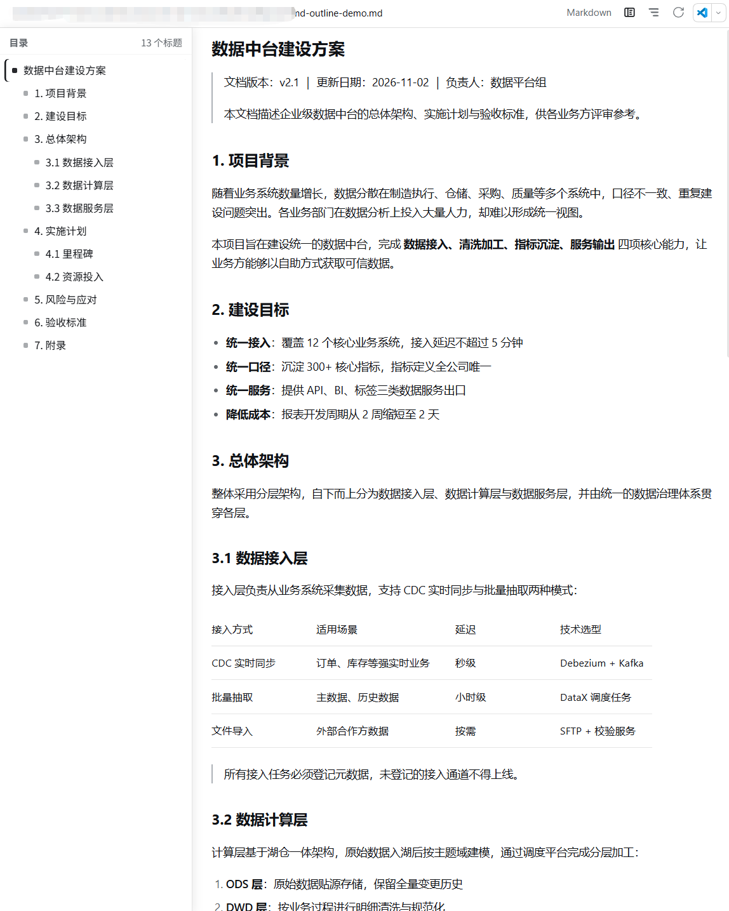
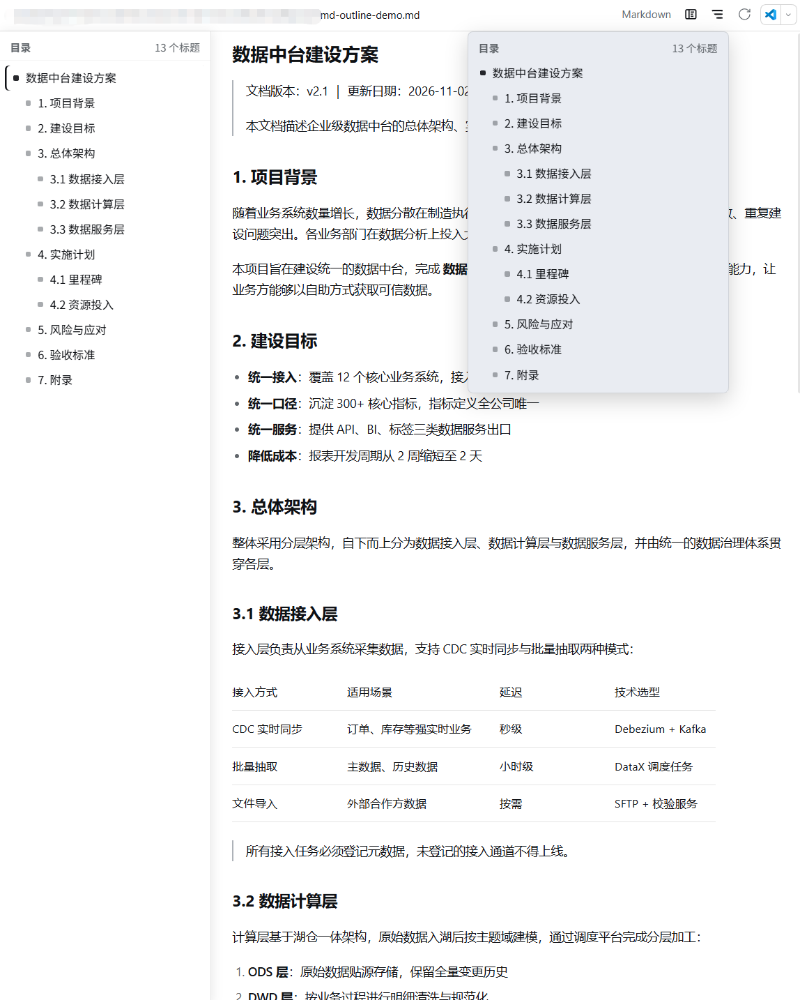

# dsh-md-outline

中文 | **English**

**Markdown outline (table of contents) plugin for the DeepSeek Harness (DSH) Web UI.**

When you preview a `.md` / `.markdown` file, the preview toolbar offers two ways to navigate quickly:

- **Outline dropdown**: click the outline button to open the heading list; click any heading to scroll straight to it
- **Persistent left outline**: toggle the panel button to pin the outline to the left of the document; the content shifts right instead of being covered; the current section is highlighted while you scroll; drag the right edge to resize; the toggle state and width are remembered

Bilingual (English / Chinese), follows the DSH theme (light / dark), and keeps the outline in sync while long documents load incrementally.

## Preview

**Persistent left outline** — pinned beside the document, current section highlighted, width adjustable by dragging:



**Toolbar outline dropdown** — the full heading list, click to jump:



## Features

| Feature | Description |
| --- | --- |
| Outline dropdown | Toolbar button; click a heading to scroll to it |
| Persistent left outline | Toolbar toggle; the content shifts right, nothing is covered |
| Scroll highlight | The current section is highlighted in the panel (brand accent bar) |
| Drag to resize | Panel width 160–480px, remembered across sessions |
| Remembered | Panel visibility and width stored in `localStorage` |
| Streaming-safe | The outline updates while long documents load incrementally |
| Markdown only | Registered for the official Markdown renderer id; other file types are unaffected |

## Installation

Requires DSH desktop or `dsh` 0.2.x (with the built-in `@deepseek-ai/dsh-client-ui-sidebar-documentpreview` plugin, enabled by default).

### Option 1: install directly from GitHub (recommended)

```powershell
dsh plugin --profile desktop add github:Alfen2309/dsh-md-outline
```

`dsh plugin` is a thin pnpm wrapper: it installs the package and automatically adds the bundle to the profile's activation list (`dsh.profile.bundles`). Refresh the page (F5) afterwards; restart DSH if the buttons do not appear.

> Replace `desktop` with your profile name if you use a different one: `dsh plugin --profile <name> add ...`

### Option 2: install from a local clone

```powershell
git clone https://github.com/Alfen2309/dsh-md-outline.git
dsh plugin --profile desktop add C:\path\to\dsh-md-outline
```

### Option 3: let the DSH agent install it

> Install the local plugin at `C:\path\to\dsh-md-outline`

### Update

```powershell
dsh plugin --profile desktop update dsh-md-outline
```

### Uninstall

```powershell
dsh plugin --profile desktop remove dsh-md-outline
```

After installation, open any `.md` file preview and the outline buttons appear in the toolbar.

## Usage

- Outline button (three bars) → dropdown outline → click a heading to jump
- Panel button (split view) → toggle the persistent left outline; drag its right edge to resize
- Scroll the document: the panel highlights the current section

## How it works

- Registers a toolbar control through the `sidebar.right.tab.document.action` slot under the official Markdown renderer id `@deepseek-ai/dsh-client-ui-sidebar-documentpreview/markdown`, so it only appears for Markdown previews and leaves other file types untouched.
- Headings are extracted from the rendered `h1`–`h6` elements; a `MutationObserver` keeps the outline in sync while content streams in.
- The persistent panel shifts the content right with a `:has()` rule and re-checks its geometry every frame, so it stays aligned through layout changes (sidebar toggles, main panel resize, changed-file banner).
- No build step and no runtime dependencies: plain ESM plus browser React.

## Compatibility

- Developed and verified against DSH `0.2.x` (`@deepseek-ai/dsh-desktop-runtime 0.2.1-rc.3`).
- Depends on the built-in `@deepseek-ai/dsh-client-ui-sidebar-documentpreview` plugin.
- If DSH ever changes the Markdown renderer id, the toolbar buttons disappear silently (update the `MARKDOWN_RENDERER_ID` constant in `client.js`).

## Development

```powershell
# The plugin is pnpm-linked into the profile; edit files in this repo and refresh the page to test.
```

## License

[MIT](./LICENSE) © 2026 Alfen2309
