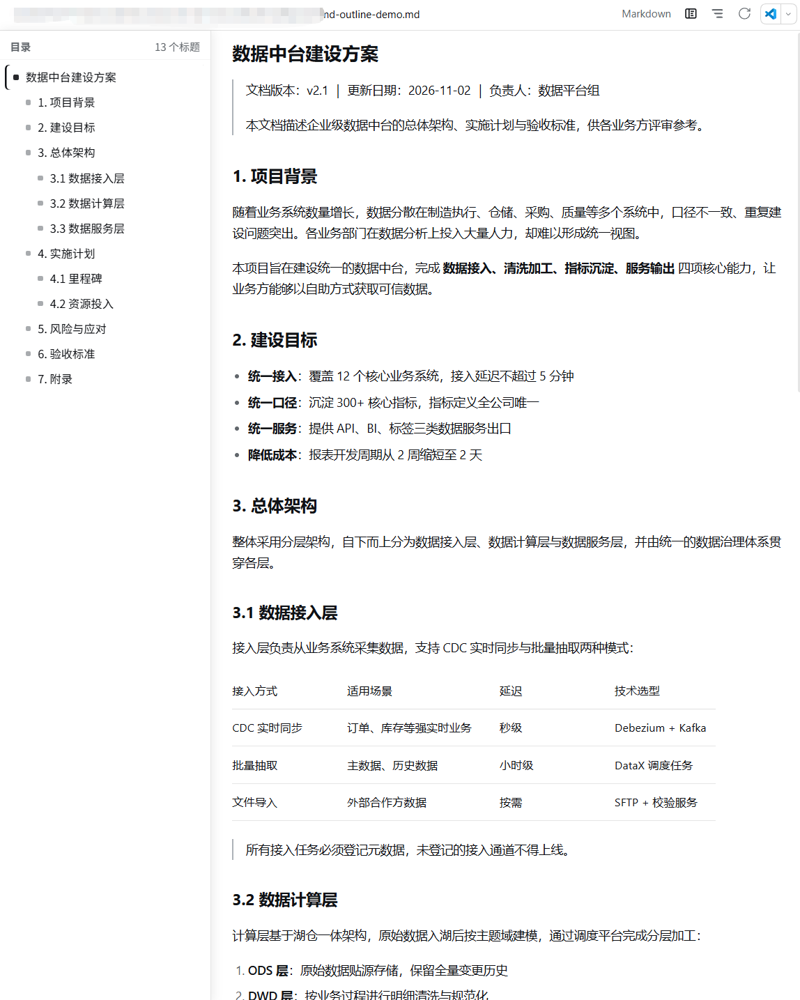
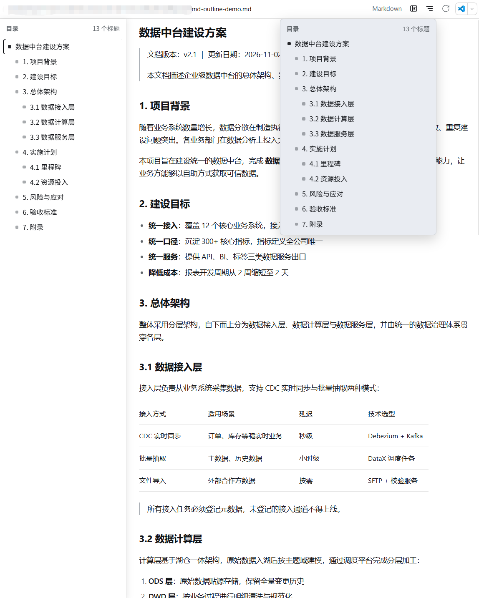

# dsh-md-outline

中文 | [English](README.en.md)

DeepSeek Harness（DSH）Web UI 的 **Markdown 目录 / 大纲** 插件。

打开 `.md` / `.markdown` 文件预览时，在工具栏提供两种快速导航方式：

- **目录下拉**：点击「目录」按钮弹出大纲，点任意标题即可滚动定位
- **左侧常驻大纲**：点「分栏」按钮开启后，预览区左侧常驻目录面板，正文自动让出空间；滚动时自动高亮当前章节；面板右缘可拖拽调宽；开关状态和宽度都会被记住

中英双语，自动跟随 DSH 主题（明 / 暗），长文档分页加载时目录实时同步。

## 预览

**左侧常驻大纲**——开启后目录常驻正文左侧，滚动时自动高亮当前章节，右缘可拖拽调宽：



**工具栏目录下拉**——点击按钮弹出完整大纲，点任意标题滚动定位：



## 功能

| 功能 | 说明 |
| --- | --- |
| 目录下拉 | 工具栏「目录」按钮，点标题滚动定位到对应位置 |
| 常驻左侧大纲 | 工具栏「分栏」按钮开关，正文右移、不再遮挡 |
| 滚动高亮 | 面板中自动高亮当前所在章节（品牌色竖条） |
| 拖拽调宽 | 面板右缘拖动调整宽度（160–480px） |
| 记忆设置 | 面板开合状态与宽度存于 localStorage，跨会话保留 |
| 流式同步 | 长文档增量加载时，目录随之实时更新 |
| 仅 Markdown | 通过官方 Markdown 渲染器 id 注册，只出现在 Markdown 预览中 |

## 安装

前提：DSH 桌面版或 `dsh` 0.2.x（内置 `@deepseek-ai/dsh-client-ui-sidebar-documentpreview` 插件，默认启用）。

### 方式一：直接从 GitHub 安装（推荐）

```powershell
dsh plugin --profile desktop add github:Alfen2309/dsh-md-outline
```

`dsh plugin` 是 pnpm 的薄封装：安装依赖的同时会自动把该 bundle 加入 profile 的激活列表（`dsh.profile.bundles`）。
安装后刷新一次页面（F5）即可看到按钮；若未生效，重启 DSH。

> profile 名不是 `desktop` 时换成自己的：`dsh plugin --profile <name> add ...`

### 方式二：克隆后本地安装

```powershell
git clone https://github.com/Alfen2309/dsh-md-outline.git
dsh plugin --profile desktop add C:\path\to\dsh-md-outline
```

### 方式三：让 DSH Agent 安装

> 帮我安装本地插件包：`C:\path\to\dsh-md-outline`

### 更新

```powershell
dsh plugin --profile desktop update dsh-md-outline
```

### 卸载

```powershell
dsh plugin --profile desktop remove dsh-md-outline
```

安装后打开任意 `.md` 文件预览，工具栏出现目录按钮。

## 使用

- 点「目录」图标（三横线）→ 下拉大纲 → 点标题跳转
- 点「分栏」图标 → 左侧常驻大纲开 / 关；拖动面板右缘调整宽度
- 滚动文档时，面板自动高亮当前章节

## 原理

- 通过 `sidebar.right.tab.document.action` 插槽、以官方 Markdown 渲染器的实现 id
  `@deepseek-ai/dsh-client-ui-sidebar-documentpreview/markdown` 注册工具栏控件，因此只出现在
  Markdown 预览中，其他文件类型不受影响。
- 目录从已渲染的标题元素（`h1`–`h6`）提取；流式加载时用 `MutationObserver` 同步。
- 常驻面板打开时通过 `:has()` 样式让正文右移，面板位置逐帧与预览区对账，布局变化（侧栏开合、
  主面板拖动、内容更新横幅）下始终贴合。
- 无构建步骤、无运行时依赖，纯 ESM + 浏览器端 React。

## 兼容性

- 面向 DSH `0.2.x` 开发与验证（`@deepseek-ai/dsh-desktop-runtime 0.2.1-rc.3`）。
- 依赖内置插件 `@deepseek-ai/dsh-client-ui-sidebar-documentpreview`。
- 若未来 DSH 改动了 Markdown 渲染器的实现 id，工具栏按钮会静默消失（需更新
  `client.js` 中的 `MARKDOWN_RENDERER_ID` 常量）。

## 开发

```powershell
# 插件以 pnpm link 方式装进 profile，直接改仓库里的文件后刷新页面即可验证
```

## License

[MIT](./LICENSE) © 2026 Alfen2309
